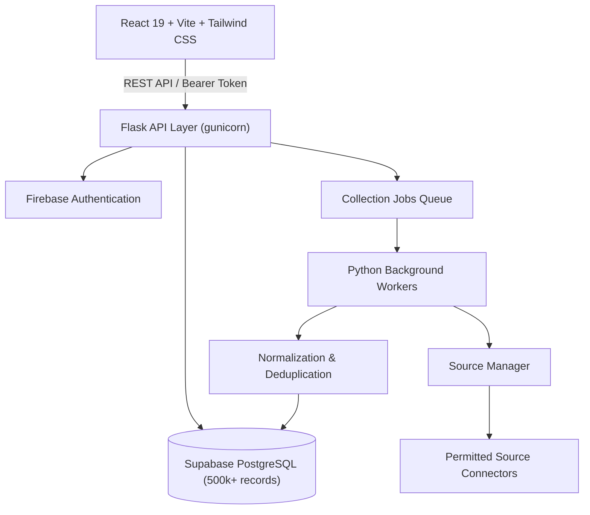

# ANDHRA SOFT TECH — LEAD FINDER

> Enterprise-Grade Business Vendor Lead Collection & Management Platform

[](#)
[](#)
[](#)
[](#)

---

## 1. Project Overview

**ANDHRA SOFT TECH — LEAD FINDER** is a scalable, modular lead collection, data validation, and spreadsheet-style lead management platform engineered to collect and manage upwards of **500,000+ vendor records** from permitted, official, and licensed data sources.

### Core Capabilities:
- **Asynchronous Data Collection Pipeline**: Configurable rate limits, source throttling, exponential backoff, and strict terms compliance.
- **Enterprise Vendor Database**: Normalized schemas in PostgreSQL with automated deduplication keys and dynamic data quality scoring.
- **Spreadsheet Data Editor**: Virtualized, server-side paginated grid with inline cell editing, custom column management, and batch operations.
- **Excel Import / Export Wizard**: Drag-and-drop file ingestion, field-level mapping, pre-import validation, and UTF-8 XLSX exports preserving clean formatting.
- **Enterprise Design System**: Clean, high-readability SaaS interface adhering to white background, soft surfaces, slate typography, and blue/purple accents.

---

## 2. Architecture & Tech Stack



### Stack Breakdown
- **Frontend**: React 19, Vite, Tailwind CSS v3, React Router v7, TanStack Query v5, Lucide React, Axios.
- **Backend (Phase 5+)**: Python, Flask, SQLAlchemy, Flask-Migrate / Alembic, Pandas, OpenPyXL.
- **Authentication**: Firebase Authentication (Admin email/password with role-based extensibility).
- **Database**: Supabase PostgreSQL with B-tree and composite indexing on dedupe keys and search parameters.
- **Deployment**:
  - Frontend: Netlify
  - Backend: Render
  - Database: Supabase

---

## 3. Project Directory Structure

```
andhra-soft-tech-lead-finder/
├── .env.example              # Environment variable specifications
├── docker-compose.yml        # Multi-service container definitions
├── README.md                 # Architecture, guide, and roadmap
├── frontend/                 # React 19 + Vite Frontend SPA
│   ├── src/
│   │   ├── assets/           # Logos, SVGs, static assets
│   │   ├── components/       # Reusable enterprise UI components
│   │   │   ├── common/       # Button, Input, Modal, Badge, Toast, Loader
│   │   │   ├── layout/       # Sidebar, Navbar, PageHeader, Footer
│   │   │   └── dashboard/    # StatCard, ProgressBar, QuickActions
│   │   ├── context/          # AuthContext, ToastContext
│   │   ├── hooks/            # Custom React hooks
│   │   ├── layouts/          # AppLayout, AuthLayout, PublicLayout
│   │   ├── pages/            # Home, Login, Dashboard, Vendors, Collections, DataEditor, Import, Settings
│   │   ├── routes/           # Protected routes and application route trees
│   │   ├── services/         # Axios API clients
│   │   └── utils/            # Data formatting, dedupe helpers, classnames
│   ├── tailwind.config.js    # Custom enterprise color palette & tokens
│   └── vite.config.js
├── backend/                  # Flask REST API backend
│   └── app/
│       ├── config/
│       ├── models/
│       ├── routes/
│       ├── services/
│       └── repositories/
├── worker/                   # Background extraction & normalization workers
│   ├── collectors/
│   ├── processors/
│   └── exporters/
├── docs/                     # Technical specifications & API contracts
└── tests/                    # Unit, integration, and load benchmarks
```

---

## 4. Development Roadmap & Phasing

- [x] **PHASE 1: Frontend Foundation** (Vite, Tailwind, routing, design system, layout shell, reusable components, Home, Login, Dashboard shell)
- [ ] **PHASE 2: Authentication Layer** (Firebase SDK integration, token persistence, role guards)
- [ ] **PHASE 3: Flask Backend API & Database Schemas** (Supabase PostgreSQL migrations, models, REST endpoints)
- [ ] **PHASE 4: Vendor Management & Details** (CRUD, search, filters, data quality score calculator)
- [ ] **PHASE 5: Spreadsheet / Data Editor** (Editable grid, dynamic custom columns, virtualization)
- [ ] **PHASE 6: Excel Import & Export Engine** (Column mapper, validation report, clean XLSX exporter)
- [ ] **PHASE 7: Collection Job System & Worker Pipeline** (Source connectors, rate throttling, deduplication)
- [ ] **PHASE 8: Production Deployment & Scale Hardening** (Netlify, Render, Supabase benchmarks)

---

## 5. Local Setup Instructions

### Prerequisites
- Node.js >= 20.x
- Python >= 3.11
- Docker & Docker Compose (optional for local Postgres)

### Frontend (Phase 1)
```bash
cd frontend
npm install
npm run dev
```
Visit `http://localhost:5173` to explore the application.

Default Local Admin Credentials (Mock Auth Mode):
- **Email**: `admin@andhrasofttech.com`
- **Password**: `admin123`

---

## 6. Permitted Source Compliance
This platform strictly adheres to fair data collection practices:
- **Zero Anti-Bot Circumvention**: No CAPTCHA solvers, IP spoofing, or session bypass.
- **Rate-Limiting & Backoff**: Requests strictly throttle according to host provider limits.
- **Permitted Data Only**: Supports official APIs, licensed data feeds, and publicly permissible listings.
